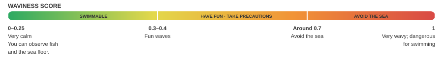
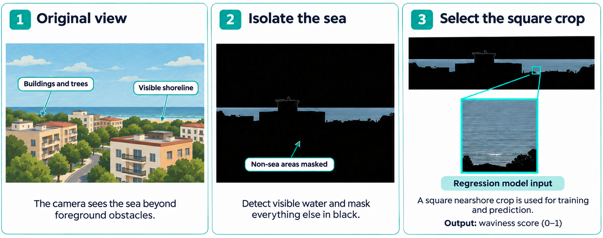
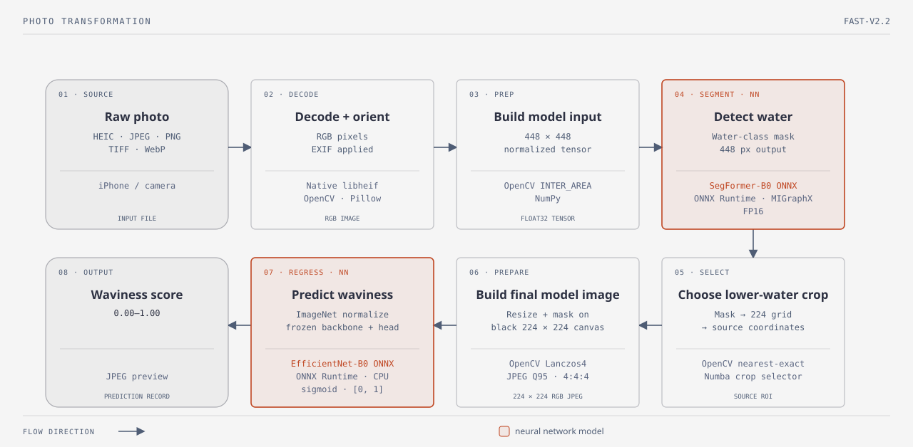
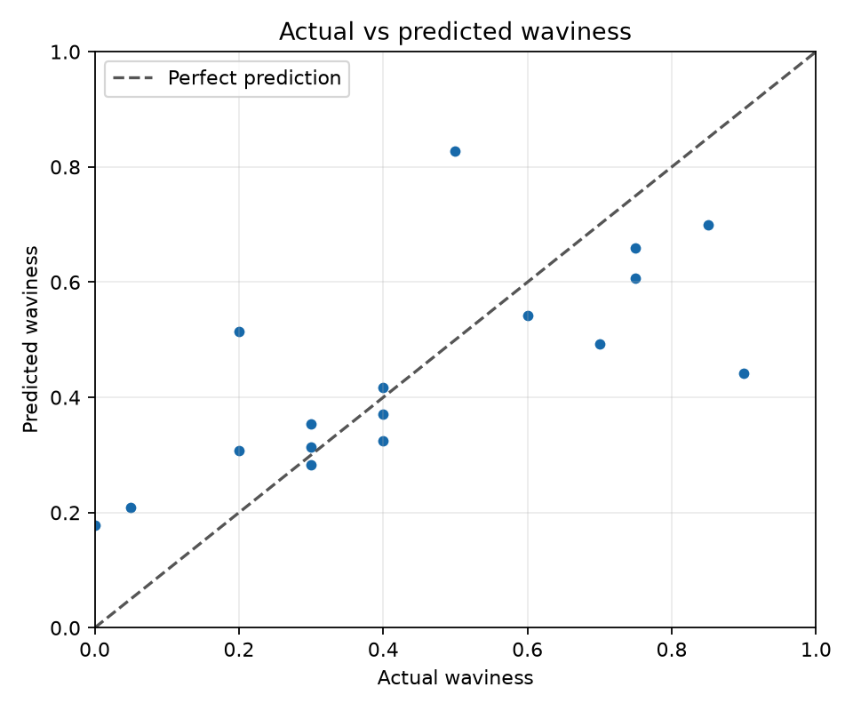
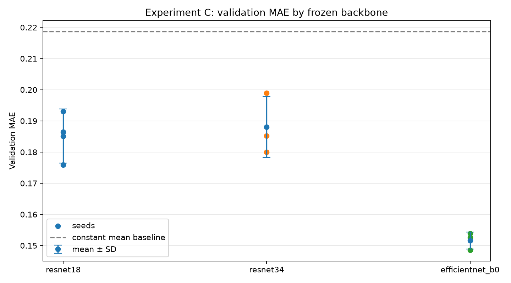

# Sea Wave Regression Model

[](https://github.com/topics/neural-networks) [](https://github.com/topics/regression-model) [](https://github.com/topics/python) [](#inference-speed-improvements)

This neural network takes a photo of the **sea** and estimates water waviness as a number from **0 to 1**. A score of 0 represents very calm water; a score of 1 represents very wavy water that may be dangerous for swimming. The score describes waviness and is not, by itself, a complete swimming safety assessment.



**Live app:** [Swimmable](https://swimmable.blaqc.space/) — see how wavy the sea is today. **Model repository:** [Hugging Face](https://huggingface.co/kubilaycaglayan/wave-regression).

**Best checkpoint:** v21 (fast-v2.2), validation MAE **0.0971**; held-out test MAE **0.1250** on 46 photos ([checkpoint evaluation](experiments/from-one-to-zero/fast-v2.2-current-checkpoint/screen-20261102T103640Z.json)).

**Warm inference benchmarks** (raw photo to score; model startup excluded):

| Hardware | Warm inference time |
| --- | ---: |
| NVIDIA GeForce GTX 1050 (4 GB VRAM), CUDA | ~195–201 ms/photo |
| Intel Core i7-8750H @ 2.20 GHz, CPU | ~259–283 ms/photo |
| Radeon 8060S GPU | **42 ms median per photo** |

This project explores whether a photo of the sea can help answer a familiar local question: **how wavy is the water today, and is it a good day to swim?** Swimming is part of everyday life where I live, and I used to check the sea from my window each morning. I started collecting photos to see whether a computer vision model could make that daily check more consistent.

The repository contains an image-processing and model-training pipeline for a local swimming application. The model estimates **water waviness from an image**; it does not yet make a complete safety judgment.

## How the pipeline prepares an image

Photos are taken from roughly 200–300 metres from the sea, often from a few recurring locations and angles. The preprocessing pipeline focuses on the sea, removing visual distractions such as sky, buildings, beach, and sand. It then selects a region toward the bottom of the detected sea area, where waves near the coast are most relevant to the swimming experience.

<p align="center">
  
  <br /><em>An original photo and the lower-water crop used as model input.</em>
</p>

For the current fast-v2.2 pipeline, during pre-processing the pipeline segments the sea and selects a lower-water crop directly from the original photo to create the final model input. The model is trained on this image.

<p align="center">
  <a href="documents/fast-v2.2-inference-flow.html">
    
  </a>
</p>

### Inference speed improvements

The earliest recorded prediction benchmark took **18.5 s** for a fresh prediction. The fastest full-pipeline benchmark took **42 ms** median per photo. The table uses stage timings from those two benchmark reports only: the first CPU benchmark for “Before” and the fastest FP16 benchmark for “After.”

<table>
  <thead>
    <tr>
      <th rowspan="2" align="left">⚙️ Change</th>
      <th colspan="2" align="center">⏪ Before</th>
      <th colspan="2" align="center">⏩ After</th>
      <th rowspan="2" align="right" nowrap>📈 Improvement</th>
    </tr>
    <tr>
      <th align="right">Time</th>
      <th align="left">Technology</th>
      <th align="right">Time</th>
      <th align="left">Technology</th>
    </tr>
  </thead>
  <tbody>
    <tr>
      <td>🧩 Step 1 segmentation</td>
      <td align="right"><code>8.7 s</code></td>
      <td><span style="display:inline-block;background:#eef2f7;border:1px solid #d5dce5;border-radius:999px;padding:2px 8px;font-size:0.85em;">SegFormer-B2</span><br /><span style="display:inline-block;background:#eef2f7;border:1px solid #d5dce5;border-radius:999px;padding:2px 8px;font-size:0.85em;">PyTorch CPU</span><br /><span style="display:inline-block;background:#eef2f7;border:1px solid #d5dce5;border-radius:999px;padding:2px 8px;font-size:0.85em;">Tiled</span></td>
      <td align="right"><code>14 ms</code></td>
      <td><span style="display:inline-block;background:#eef2f7;border:1px solid #d5dce5;border-radius:999px;padding:2px 8px;font-size:0.85em;">SegFormer-B0</span><br /><span style="display:inline-block;background:#eef2f7;border:1px solid #d5dce5;border-radius:999px;padding:2px 8px;font-size:0.85em;">MIGraphX FP16</span><br /><span style="display:inline-block;background:#eef2f7;border:1px solid #d5dce5;border-radius:999px;padding:2px 8px;font-size:0.85em;">448 × 448 single pass</span></td>
      <td align="right"><strong>638× faster</strong></td>
    </tr>
    <tr>
      <td>🎯 Step 2 / crop</td>
      <td align="right"><code>8.9 s</code></td>
      <td><span style="display:inline-block;background:#eef2f7;border:1px solid #d5dce5;border-radius:999px;padding:2px 8px;font-size:0.85em;">Step 2 SegFormer-B2</span><br /><span style="display:inline-block;background:#eef2f7;border:1px solid #d5dce5;border-radius:999px;padding:2px 8px;font-size:0.85em;">Crop selection</span></td>
      <td align="right"><code>5 ms</code></td>
      <td><span style="display:inline-block;background:#eef2f7;border:1px solid #d5dce5;border-radius:999px;padding:2px 8px;font-size:0.85em;">Project Step 1 mask to 224 × 224</span><br /><span style="display:inline-block;background:#eef2f7;border:1px solid #d5dce5;border-radius:999px;padding:2px 8px;font-size:0.85em;">Crop and mask original photo</span></td>
      <td align="right"><strong>1,787× faster</strong></td>
    </tr>
    <tr>
      <td>✂️ Photo decode</td>
      <td align="right"><code>4 ms</code></td>
      <td><span style="display:inline-block;background:#eef2f7;border:1px solid #d5dce5;border-radius:999px;padding:2px 8px;font-size:0.85em;">PNG · 384 × 512</span><br /><span style="display:inline-block;background:#eef2f7;border:1px solid #d5dce5;border-radius:999px;padding:2px 8px;font-size:0.85em;">Pillow</span></td>
      <td align="right"><code>18 ms</code></td>
      <td><span style="display:inline-block;background:#eef2f7;border:1px solid #d5dce5;border-radius:999px;padding:2px 8px;font-size:0.85em;">HEIC · 3024 × 4032</span><br /><span style="display:inline-block;background:#eef2f7;border:1px solid #d5dce5;border-radius:999px;padding:2px 8px;font-size:0.85em;">Native HEIF · 16 workers</span></td>
      <td align="right"><strong>Not comparable*</strong></td>
    </tr>
    <tr>
      <td>🧮 Regression</td>
      <td align="right"><code>985 ms</code></td>
      <td><span style="display:inline-block;background:#eef2f7;border:1px solid #d5dce5;border-radius:999px;padding:2px 8px;font-size:0.85em;">EfficientNet-B0</span><br /><span style="display:inline-block;background:#eef2f7;border:1px solid #d5dce5;border-radius:999px;padding:2px 8px;font-size:0.85em;">PyTorch CPU</span></td>
      <td align="right"><code>6 ms</code></td>
      <td><span style="display:inline-block;background:#eef2f7;border:1px solid #d5dce5;border-radius:999px;padding:2px 8px;font-size:0.85em;">Matched EfficientNet-B0 ONNX</span><br /><span style="display:inline-block;background:#eef2f7;border:1px solid #d5dce5;border-radius:999px;padding:2px 8px;font-size:0.85em;">ONNX Runtime CPU</span></td>
      <td align="right"><strong>169× faster</strong></td>
    </tr>
    <tr>
      <th align="left">🚀 Total raw photo → waviness score</th>
      <td colspan="2" align="right"><strong>18.5 s</strong></td>
      <td colspan="2" align="right"><strong>42 ms</strong></td>
      <td align="right"><strong>436× faster</strong></td>
    </tr>
  </tbody>
</table>

\* The decode measurements use different inputs: one 384 × 512 PNG (0.2 megapixels) versus 3024 × 4032 HEIC photos (12.2 megapixels, about 62× as many pixels) decoded by the native tiled HEIF decoder with 16 workers. The 4 ms and 18 ms results do not establish that native HEIF decoding is slower.*

See the [first benchmark](step-7-prediction-benchmarks/20261027T091535089295Z/benchmark.json) and [fastest matched FP16 benchmark](experiments/from-one-to-zero/fp16-retrained-regressor/screen-20261102T102000Z.json).

## Model development

The first model versions used a ResNet backbone. An early version reached a validation mean absolute error (MAE) of about **0.10**. As we added more photographs, the dataset also gained noisier or more ambiguous examples, and the validation MAE rose across subsequent versions, reaching about **0.17**.

That prompted a set of controlled experiments to understand model behavior and improve it. We designed experiments in a way that they can be repeated, and the repeated experiment results will be recorded in versioned directories.

### Experiment A — Constant prediction baselines

We compared the neural network with two simple guesses that do not use the validation photos, then measured them against the network's image-based predictions. Here is how the experiment works:

1. Calculate the average waviness label from the training photos.
2.  Assign that same average score as the guess for every validation photo, without looking at the photo.
3. Compare each fixed guess with that validation photo's actual waviness label.
4. Calculate the average error across all validation photos. This is the baseline's mean absolute error (MAE).
5.  Repeat steps 2–4 using the middle training-set score (the median) as the same fixed guess for every validation photo.
6.  Load the selected neural network checkpoint and give it each validation image. The model looks at each image and predicts its waviness score.
7. Compare the model's MAE with the two baseline MAEs, calculated on the same validation photos.

In this run, the training-mean baseline had an MAE of **0.219**, the training-median baseline had an MAE of **0.222**, and the EfficientNet-B0 model had an MAE of **0.141** on 17 validation images. Lower MAE means the predictions were closer to the actual labels on average. The test set was not evaluated in this experiment. [Read the baseline report](readme_files/experiment-a-baseline-report.md).

### Experiment B — Per-image error analysis

Aggregate MAE can hide individual failures. We plotted actual and predicted waviness for each validation image and reviewed prediction errors image by image. The analysis helps identify cases where the model performs well or struggles, and guides later data collection and experiments.



*Each point represents a validation image. The diagonal indicates a perfect prediction.*

### Experiment C — Frozen backbone comparison

We compared frozen pretrained ResNet-18, ResNet-34, and EfficientNet-B0 backbones across three random seeds, using the same recent dataset split. EfficientNet-B0 had the lowest mean validation MAE: **0.152**, compared with **0.185** for ResNet-18 and **0.188** for ResNet-34. The backbones performed similarly in some respects, but EfficientNet-B0 gave the strongest average result in this experiment and became the preferred backbone for continued work.



*Mean validation MAE across three seeds; lower is better. This comparison used validation data, not the held-out test set.*

### Experiment D — Partial fine-tuning

Next, we unfroze the final layer of the EfficientNet-B0 backbone to test whether partial fine-tuning helped. It did not improve average validation MAE: the partially fine-tuned model scored **0.156**, compared with **0.152** for the frozen model, and it performed worse across all three paired seeds. For this dataset snapshot, the results favor keeping the backbone frozen. The validation set is small, so this is evidence for the current setup rather than a general claim. [Read the Experiment D report](readme_files/experiment-d-partial-finetuning-report.md).

## Current status

- The pipeline is designed for a dataset that grows over time. Images are labeled with a waviness score from 0 to 1, and training, validation, and test splits are managed separately.
- The pipeline supports image preprocessing, labeling, dataset splits, training, evaluation, and inference.
- Step 7 now defaults to **fast-v2.2**: native HEIF decoding when available (with a Pillow fallback), 448×448 SegFormer-B0 ONNX segmentation through MIGraphX FP16, lower-water coordinate crop from the source image, and the retrained EfficientNet-B0 ONNX regressor. The earlier fast-v2.1 and PyTorch v19 routes remain selectable.
- EfficientNet-B0 is the current preferred backbone based on validation experiments.
- The v21 fast-v2.2 checkpoint was selected at **0.0971 validation MAE** and reached **0.1250 test MAE** across 46 held-out photos; see the [checkpoint evaluation](experiments/from-one-to-zero/fast-v2.2-current-checkpoint/screen-20261102T103640Z.json).
- The first model version is available on [Hugging Face](https://huggingface.co/kubilaycaglayan/wave-regression).
- More varied, carefully labeled data is needed to evaluate how well predictions generalize across days, weather, locations, and camera angles.

## Run the project

### Set up the environment

Run commands from the repository root. Use Python 3.14 on this machine and
create an isolated environment:

```bash
python3 -m venv .venv
source .venv/bin/activate
python -m pip install --upgrade pip
```

After setup, follow the [pipeline run guide](README_RUN.md) for preprocessing,
labeling, training, evaluation, and prediction steps.

## About this project

This is a learning project built around a practical local question. The goal is to make each pipeline stage inspectable, preserve experiment results, and improve the model as new sea photographs and labels are collected.
