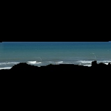

# Pipeline run guide

Set up Python and install dependencies as described in the main
[README](README.md#run-the-project). Then return here to follow the pipeline
steps. Put the input photos in `step-0-raw-data/` before starting.

```bash
python step_1_b_preprocess_water_inputs.py
python step_2_a_reduce_black_water_area.py
python step_2_b_label_data.py        # labeling UI at http://localhost:8055, saves labels.csv
python step_3_a_prepare_dataset_split.py
python train.py                       # EfficientNet-B0 default
# Or select explicitly:
python train.py --backbone resnet18
python train.py --backbone efficientnet_b0
python step_6_a_evaluate_test.py
```

Predict one or more new photos:

```bash
# put HEIC/JPG/PNG in step-7-predict-captures-holder/, then:
python step_7_a_predict.py
# Optionally limit PyTorch CPU threads after benchmarking your hardware.
python step_7_a_predict.py --threads 4
# previews -> step-7-inference-preview/
# prediction histories -> step-7-predict-captures-holder/predictions/
```

Notes: steps skip existing outputs, so reruns are safe. Use `--device cpu` on the step 1/2 scripts to force CPU.

Step 7 reuses valid cached inference previews when switching checkpoints.

The repository’s retraining flow is:

`new raw photos → Step 1 preprocessing → Step 2 lower-water crop → manual labels → dataset split → training → optional evaluation/inference`

Run all commands from:

```bash
cd /path/to/wave-regression-model
```

## Step 0: Add the new photos

Copy new JPEG, PNG, HEIC, HEIF, TIFF, BMP, or WebP photos into:

```text
step-0-raw-data/
```

Use unique filenames containing an image number, for example:

```text
IMG_7400.jpg
IMG_7401.jpg
IMG_7402.jpg
```

The split script requires filenames containing an `IMG_<number>` pattern.

Do not replace an existing photo with the same filename unless you also remove its generated pipeline outputs. Existing output filenames cause later steps to skip that image.

## Step 1: Prepare the water inputs

### Optional: create water-mask previews

This is for inspecting whether the pretrained segmentation model correctly detects the sea:

```bash
python step_1_a_prepare_water_masks.py
```

Open this file in a browser:

```text
step-1-water-mask-preview/index.html
```

Inspect the original, mask, and overlay images. The generated `original` and `overlay` files are previews and should not be committed.

### Create standardized Step 1 inputs



Run:

```bash
python step_1_b_preprocess_water_inputs.py
```

For CPU-only processing:

```bash
python step_1_b_preprocess_water_inputs.py --device cpu
```

This reads from:

```text
step-0-raw-data/
```

and writes standardized `224x224` images to:

```text
step-1-processed-data/
```

Open:

```text
step-1-processed-data/index.html
```

The script skips images whose `step-1_<name>.jpg` output already exists.

## Step 2: Create and label the lower-water images

### Create the lower-water Step 2 images


Run:

```bash
python step_2_a_reduce_black_water_area.py
```

For CPU-only processing:

```bash
python step_2_a_reduce_black_water_area.py --device cpu
```

This reads the Step 1 outputs and writes:

```text
step-2-final-water-data/
```

The crop selection is designed to retain the lower part of the detected water area, where waves are expected to be most visible.

Inspect the result here:

```text
step-2-final-water-data/index.html
```

The script skips images whose `step-2_<name>.jpg` output already exists.

### Label the new Step 2 images

Start the labeling web app:

```bash
python step_2_b_label_data.py
```

Open this URL:

```text
http://localhost:8055
```

In the labeling UI:

1. Select “Unlabeled first”.
2. Set the waviness value from `0.00` to `1.00`.
3. Use increments of `0.05`.
4. Click “Save & Next”.
5. Continue until all new images are labeled.
6. Stop the server with `Ctrl+C`.

Labels are saved automatically to:

```text
labels.csv
```

The existing labels are preserved. You do not need to manually edit the CSV.

## Step 3: Rebuild the dataset splits

Run:

```bash
python step_3_a_prepare_dataset_split.py
```

This validates that:

- every labeled image exists in `step-2-final-water-data/`;
- labels are between `0.0` and `1.0`;
- filenames are unique and contain an image number;
- no capture group is split across train, validation, and test.

Existing split membership remains fixed. New samples are assigned incrementally, so previously trained data is not randomly reshuffled. If you correct a label in `labels.csv`, the sample stays in its current split and the next snapshot uses the corrected value; prior snapshots remain unchanged. Images in `discarded_images.csv` are omitted from the next current manifests and snapshot.

Review:

```text
step-3-dataset-splits/summary.txt
```

The generated manifests are:

```text
step-3-dataset-splits/train.csv
step-3-dataset-splits/validation.csv
step-3-dataset-splits/test.csv
```

A timestamped immutable snapshot is also created under:

```text
step-3-dataset-splits/snapshots/
```

## Step 4: Inspect the training data

Run:

```bash
python step_4_c_inspect_training_data.py
```

Then open:

```text
step-4-data-preview/index.html
```

This checks tensor shapes, labels, deterministic validation/test transforms, and displays training augmentations.

## Step 5: Train a new model

Run:

```bash
python train.py
```

The training script:

- loads `train.csv` and `validation.csv`;
- uses the existing preprocessing outputs;
- automatically chooses the next model version;
- does not overwrite earlier checkpoints;
- saves the best checkpoint based on validation MAE;
- uses early stopping;
- writes a training summary and manifest.

New checkpoints will be created in:

```text
step-5-checkpoints/vN-mae-<best-mae>-<backbone>/
```

Each training version directory contains its checkpoint, manifest, summary,
training history, and plots. Existing legacy version directories can be renamed with:

```bash
python migrate_step_5_checkpoints.py --dry-run --fallback-backbone resnet18
python migrate_step_5_checkpoints.py --fallback-backbone resnet18
```

Use `--fallback-backbone` only for legacy directories whose checkpoint metadata
cannot identify the architecture. The current historical Step 5 directories
are ResNet18 runs.

The command prints the exact best checkpoint path. Use that path for later evaluation or prediction.

## Step 6: Evaluate the test set

Run:

```bash
python step_6_a_evaluate_test.py
```

The evaluation uses `test.csv` from the latest dataset split snapshot by default and automatically selects the newest training manifest's best checkpoint. To evaluate a specific checkpoint, set `EVALUATION_CHECKPOINT_PATH` to its path. Use `--test-manifest` to select another test CSV.

Results are written to a checkpoint- and SHA-256-specific directory under:

```text
step-6-test-evaluation/
```

Each result directory is keyed by the checkpoint filename and SHA-256, then by the split snapshot ID and test-manifest SHA-256. Predictions, summary, gallery, and metadata stay together. A complete evaluation for the same checkpoint and manifest is reused on later runs; a new split snapshot or checkpoint gets its own directory.

## Step 7: Use the new checkpoint for predictions

Configure the prediction checkpoint in `.env` (or the environment) using:

```text
# Use the exact best-checkpoint path printed by train.py.
PREDICT_CHECKPOINT_PATH=step-5-checkpoints/vN-mae-<best-mae>-<backbone>/<best-checkpoint>.ckpt
```

After training, update `PREDICT_CHECKPOINT_PATH` to the new checkpoint path printed by `train.py`.

Then put new inference photos in:

```text
step-7-predict-captures-holder/
```

Run:

```bash
python step_7_a_predict.py
```

Predictions and processed previews are written to:

```text
step-7-inference-preview/
step-7-predict-captures-holder/predictions/
```

The prediction directory contains one append-only `.txt` history per input photo. Each record includes the waviness prediction, selected checkpoint path, checkpoint SHA-256, timestamp, device, and elapsed processing time. A valid `step-7-inference-preview/<photo-stem>-model-input.jpg` is the checkpoint-independent cached model input, so changing checkpoints reuses the preview and reruns only regression inference. A photo is skipped only when both its valid preview and a record for the same checkpoint are present. Missing previews trigger Steps 1 and 2; malformed previews fail clearly rather than being silently replaced. Delete a preview to force regeneration.

To keep models loaded for incoming photos, run `python step_7_e_watch_predictions.py --threads 4` and stop it with Ctrl+C. It warms both models at startup and, on Linux, immediately handles files after a writer closes them or atomically moves them into the folder. Write each photo with one writer, or preferably stage it elsewhere and atomically move it into the folder with a unique filename; multiple writers or later modifications cannot be made safe by a close notification alone. Files already present at startup are checked with stability polling. If notifications are unavailable, it falls back to checking size and modification time across two polls; `--watch-mode poll` forces that behavior and `--watch-mode event` requires notifications. An unchanged failed file is reported once and retried when it changes. Restart the watcher to select a newly configured checkpoint. New image shapes and tile counts may still incur additional costs.

For an explicit experimental fast path, use `python step_7_e_watch_predictions.py --threads 4 --experimental-single-resolution 384 --experimental-logits-resolution 384`. This changes the water masks and predictions; review the validation comparison before relying on its output. Add `--experimental-reuse-step1-mask` to test omitting the second segmentation pass. Experimental previews and prediction records use a separate namespace derived from the settings and pipeline code, so they cannot be mistaken for baseline results. The watcher polling delay is separate from the prediction timings.

To test different stage resolutions and GPU precision, use `python step_7_e_watch_predictions.py --threads 4 --experimental-single-resolution 448 --experimental-step2-resolution 384 --experimental-logits-resolution 448 --experimental-precision float16`. A watcher started on CPU uses full precision and a separate device-specific output namespace. If experimental GPU segmentation falls back to CPU while running, it fails clearly before saving that preview so different device and precision results are not mixed. This is also experimental and uses a separate output namespace.

### Benchmark prediction latency

```bash
# Default: photos in the prediction holder, three independent processes.
python step_7_b_benchmark_prediction.py --repeat 3
# Or select photos and a device explicitly.
python step_7_b_benchmark_prediction.py --device cpu --repeat 3 /path/to/photo.HEIC /path/to/photo.jpg
```

The benchmark measures cold and warm predictions using an existing preview when available, without changing prediction outputs. Each run saves timing and system details as JSON and Markdown in a timestamped folder under `step-7-prediction-benchmarks/`.

To include Linux notification delivery and scheduling, measure an atomic photo arrival through the completed record in an isolated warmed watcher:

```bash
python step_7_h_benchmark_arrival.py --checkpoint /path/to/experimental.ckpt --resolution 448 --step2-resolution 384 --logits-resolution 448 --precision float16 /path/to/photo.HEIC
```

This benchmark delivers one existing photo at a time via a temporary symlink and atomic move. It does not measure upload/copy time, model startup, or queued requests. It requires Linux notifications and reports a nearest-rank p95 when multiple photos are provided.

For a fresh-photo latency distribution, force preprocessing and repeat warm runs. The p95 uses the nearest-rank method; use enough representative photos and repeats, and inspect failures separately:

```bash
python step_7_b_benchmark_prediction.py --device cuda --threads 4 --fresh --repeat 1 --warm-runs 5 /path/to/photo.HEIC
# Experimental settings only: these can change masks, crops and predictions.
python step_7_b_benchmark_prediction.py --device cuda --threads 4 --fresh --repeat 1 --warm-runs 5 --resolution 384 --step2-resolution 384 --no-tiles /path/to/photo.HEIC
# Optional additional experiment: reuse the projected Step 1 mask in Step 2.
python step_7_b_benchmark_prediction.py --device cuda --threads 4 --fresh --repeat 1 --warm-runs 5 --resolution 384 --no-tiles --reuse-step1-mask /path/to/photo.HEIC
# Optional experiment: use a different Step 2 size and GPU autocast.
python step_7_b_benchmark_prediction.py --device cuda --threads 4 --fresh --repeat 1 --warm-runs 5 --resolution 448 --step2-resolution 384 --precision float16 --no-tiles --logits-resolution 448 /path/to/photo.HEIC
```

The normal prediction pipeline retains its original segmentation settings. For a quality comparison on labeled validation images, run the following commands with two new output paths. The first uses existing Step 1 outputs and reruns Step 2 at both resolutions; the second compares persisted Step 2 validation images with the experimental single-image raw-photo pipeline. The latter requires the Step 1 source manifest and original photos to be available locally.

```bash
python step_7_d_compare_preprocessing.py --device cuda --candidate-resolution 384 --output /tmp/wave-step2-comparison.json
python step_7_d_compare_preprocessing.py --device cuda --candidate-resolution 384 --raw-candidate --output /tmp/wave-raw-comparison.json
# Experimental: project the Step 1 mask into Step 2 instead of running a second segmentation.
python step_7_d_compare_preprocessing.py --device cuda --candidate-resolution 384 --raw-candidate --reuse-step1-mask --output /tmp/wave-mask-comparison.json
# Compare separate stage resolutions and GPU precision against saved validation inputs.
python step_7_d_compare_preprocessing.py --device cuda --candidate-resolution 448 --step2-resolution 384 --precision float16 --logits-resolution 448 --raw-candidate --output /tmp/wave-precision-comparison.json
```

MAE is calculated on examples that succeeded in both variants; examine failure counts as well. Neither command saves source images or altered crops.

### Compare an adapted fast-preprocessing regression head

```bash
python step_7_f_fast_head_experiment.py --output-dir /tmp/wave-fast-head --holdout-by-date
```

This optional experiment freezes the selected checkpoint's backbone, fits only its regression head using the training split, selects its epoch and teacher weighting on separate training capture dates, and evaluates the validation split. Date holdout requires usable EXIF capture dates and fails instead of guessing if they are missing. It does not read the test split or change the selected checkpoint. Its output checkpoint is experimental: use it only with the recorded preprocessing settings. Feature vectors are cached under `step-7-prediction-benchmarks/fast-head-feature-cache/` and keyed by source, prior-stage output, checkpoint, model revision, device and code fingerprints; unchanged photos are reused across runs. Use a new `--output-dir` for each completed experiment. These features are not source images, but should still be treated as derived data.

For example, an experimental 448 / 384 float16 checkpoint can be tried without changing `.env`:

```bash
PREDICT_CHECKPOINT_PATH=/path/to/experimental.ckpt python step_7_e_watch_predictions.py --threads 4 --experimental-single-resolution 448 --experimental-step2-resolution 384 --experimental-logits-resolution 448 --experimental-precision float16
```

Prediction and benchmark entry points verify the adapted checkpoint's recorded settings, relevant code and segmentation model revision. They reject mismatches rather than silently pairing the head with different preprocessing. Benchmarking an adapted checkpoint against raw photos requires `--fresh` if a baseline preview already exists. Startup, notification delivery and queueing, and any polling or file-stability waiting are additional to the prediction times.

### Profile prediction operators

```bash
python step_7_c_profile_prediction.py --device cpu /path/to/photo.HEIC
python step_7_c_profile_prediction.py --device cuda --threads 4 --warmup 1 --repeat 2 --shapes --memory /path/to/photo.HEIC
```

This separate profiling run captures both segmentation passes and the regression forward pass; its timings include profiler overhead and are not latency benchmarks. Reports and Chrome/Perfetto traces are saved under `step-7-prediction-profiles/`.

## Step 8: Run the baseline experiment

```bash
python step_8_experiment_a_constant_prediction_baselines.py
```

Step 8 compares training-mean and training-median baselines with the matching neural-network checkpoint. Each run writes JSON and Markdown reports to a new `vN-timestamp/` folder under `step-8-experiment-a-baseline/`; test data is not evaluated.

## Step 9: Review per-image errors

```bash
python step_9_experiment_b_per_image_error_analysis.py
```

Step 9 shows which validation images the model understands well and where its waviness judgments are least reliable. It helps reveal patterns in the model’s mistakes so future improvements can focus on the images that need the most attention.

Each run writes to a new `vN-timestamp/` folder under the checkpoint and split snapshot result path in `step-9-experiment-b-per-image-error-analysis/`.

## Step 10: Compare frozen backbones

```bash
python step_10_experiment_c.py
```

Step 10 compares three frozen ImageNet backbones across three seeds using the newest valid dataset split by default. Results are kept in a versioned folder under `step-10-experiment-c-frozen-backbone-comparison/`. Pass `--dry-run` to check the selected split and planned runs without training.

## Step 11: Experiment D — frozen vs partially fine-tuned EfficientNet-B0

Read the [Experiment D protocol](step-11-experiment-d-efficientnet-partial-finetuning/EXPERIMENT-D.md)
and [configuration audit](step-11-experiment-d-efficientnet-partial-finetuning/CONFIGURATION_AUDIT.md).
To run all six paired seeds on the specified immutable snapshot:

```bash
python step_11_experiment_d.py
```

Each execution writes to a version directory under
`step-11-experiment-d-efficientnet-partial-finetuning/`. Interrupted matching
versions resume completed runs safely; use `--force-new` to start a separate
version. Use `--dry-run` to validate the snapshot and list the six planned
runs without training.

## Important notes

- `step_1_a_prepare_water_masks.py` is an inspection step; `step_1_b_preprocess_water_inputs.py` is the actual Step 1 training-data preparation.
- Do not train directly from raw photos. Training uses the Step 2 outputs.
- Existing sample split membership is preserved across updates. Label corrections and discarded samples are reflected in new snapshots; historical snapshots remain unchanged for reproducibility.
- `step_6_a_evaluate_test.py` uses `test.csv` from the latest split snapshot by default and automatically selects the newest training manifest's best checkpoint. Set `EVALUATION_CHECKPOINT_PATH` to pin a historical checkpoint, or pass `--test-manifest` to select a test CSV. Results are stored under checkpoint- and split-manifest-specific directories in `step-6-test-evaluation/`; complete matching evaluations are reused on later runs.
