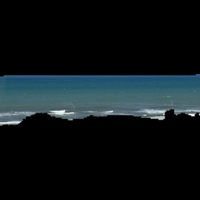

# Pipeline run guide · fast-v2.2

Set up Python and install dependencies as described in the main
[README](README.md#run-the-project). Then return here to follow the pipeline
steps. Put the input photos in `step-0-raw-data/` before starting.

```bash
python scripts_pipeline/step_1_b_preprocess_water_inputs.py
python scripts_pipeline/step_2_a_label_data.py        # labeling UI at http://localhost:8055
python scripts_pipeline/step_3_a_prepare_dataset_split.py
python scripts_pipeline/train.py                     # fast-v2.2 + EfficientNet-B0 defaults
python scripts_pipeline/step_6_a_evaluate_test.py
```

Predict one or more new photos (the default backend is fast-v2.2):

```bash
# put HEIC/JPG/PNG in step-7-predict-captures-holder/, then:
python scripts_pipeline/step_7_a_predict.py
# Optional: use the earlier fast-v2.1 or previous PyTorch v19 inference path.
python scripts_pipeline/step_7_a_predict.py --backend fast-v2.1
python scripts_pipeline/step_7_a_predict.py --backend torch-v19
# Optionally use the previous PyTorch backend and limit its CPU threads.
python scripts_pipeline/step_7_a_predict.py --backend torch-v19 --threads 4
# previews -> step-7-inference-preview/<profile namespace>/
# prediction histories -> step-7-predict-captures-holder/predictions/
```

The default prediction backend is fast-v2.2: native HEIF decoding and orientation, 448×448 tensor preparation, distilled SegFormer-B0 ONNX segmentation on MIGraphX with FP16 enabled, nearest-exact mask projection to 224×224, lower-water coordinate selection, source-coordinate crop mapping, Lanczos4 resizing and mask application on a black 224×224 canvas, then a quality-95 full-chroma JPEG roundtrip. The fast-v2.2 EfficientNet-B0 regressor runs on ONNX Runtime CPU with ImageNet normalization. It writes the final model-input preview under `step-7-inference-preview/fast-v2.2-migraphx/`. The service starts and stops with each prediction batch. Its default runtime interpreter is `/tmp/wave_migraphx_312_env/bin/python`; override it with `PREDICT_MIGRAPHX_PYTHON` if needed. The matched regressor is `models/fast-v2.2/wave-regression-efficientnet-b0-fast-v2.2.onnx` and can be overridden with `PREDICT_REGRESSOR_ONNX_PATH`. The previous PyTorch v19 route remains available as `--backend torch-v19`.

The fast-v2.2 prediction route requires a Python 3.12 runtime with `onnxruntime` and `onnxruntime-ep-migraphx`, plus access to the ROCm libraries. Its regressor and model manifest are in `models/fast-v2.2/`; it reuses the distilled SegFormer-B0 ONNX file in `models/fast-v2.1/` with FP16 enabled by MIGraphX. If the runtime is missing, prediction stops with an error instead of silently falling back.

Training and batch preprocessing default to the `fast-v2.2` profile. Step 1 calls the same MIGraphX FP16 SegFormer service as prediction and saves the final 224×224 RGB JPEG used by the regressor. This image goes directly to labeling, splitting, and training; split snapshots are marked `fast-v2.2`. Run the commands at the top of this guide in order to prepare, label, split, train, and evaluate data using that profile. `train.py` trains a PyTorch checkpoint; prediction uses the shipped fast-v2.2 ONNX export until you explicitly export and select a later checkpoint.

Step 7 reuses valid cached inference previews when switching checkpoints.

The repository’s retraining flow is:

`new raw photos → Step 1 final model inputs → manual labels → dataset split → training → optional evaluation/inference`

Run all commands from:

```bash
cd /path/to/wave-regression-model
```

## Step 0: Add the new photos

Copy new JPEG, PNG, HEIC, HEIF, TIFF, BMP, or WebP photos into:

```text
step-0-raw-data/
```

Use unique filenames containing an image number, for example:

```text
IMG_7400.jpg
IMG_7401.jpg
IMG_7402.jpg
```

The split script requires filenames containing an `IMG_<number>` pattern.

Do not replace an existing photo with the same filename unless you also remove its generated pipeline outputs. Existing output filenames cause later steps to skip that image.

## Step 1: Prepare the water inputs

### Optional: create water-mask previews

This is for inspecting whether the pretrained segmentation model correctly detects the sea:

```bash
python scripts_pipeline/step_1_a_prepare_water_masks.py
```

Open this file in a browser:

```text
step-1-water-mask-preview/index.html
```

Inspect the original, mask, and overlay images. The generated `original` and `overlay` files are previews and should not be committed.

### Create coordinate-cropped Step 1 model inputs



Run the default fast-v2.2 FP16 coordinate-crop preprocessing flow used by training and prediction:

```bash
python scripts_pipeline/step_1_b_preprocess_water_inputs.py
```

The fast-v2.2 profile requires the configured Python 3.12 MIGraphX runtime and ROCm libraries. It uses FP16 SegFormer inference and writes the final regressor JPEG. The same runtime setting used for prediction, `PREDICT_MIGRAPHX_PYTHON`, is used here. To use an older preprocessing path explicitly, select its profile:

```bash
python scripts_pipeline/step_1_b_preprocess_water_inputs.py --profile baseline-v16 --device cpu
```

This reads each new photo from:

```text
step-0-raw-data/
```

and writes the final lower-water coordinate-crop model input as `224x224` images to:

```text
step-1-processed-data/fast-v2.2/
```

Open:

```text
step-1-processed-data/fast-v2.2/index.html
```

The script skips images whose `step-1_<name>.jpg` output already exists.

For the default `fast-v2.2` profile, Step 1 calls the isolated MIGraphX runtime with FP16 enabled, predicts the water mask at 448 pixels, projects it to 224×224 using nearest-exact interpolation, selects the lower-water coordinate crop, and maps that crop back to the source photo. It creates the 224×224 masked RGB JPEG used by training and inference (Lanczos4 image resize, nearest-exact mask resize, quality 95 with 4:4:4 subsampling). Crop selection prefers the lower part of detected water, where waves are expected to be most visible. This is the final model input; no additional crop or copy stage is required.

Inspect the final model inputs here:

```text
step-1-processed-data/fast-v2.2/index.html
```

## Step 2: Label the final model inputs

Start the labeling web app:

```bash
python scripts_pipeline/step_2_a_label_data.py
```

Open this URL:

```text
http://localhost:8055
```

In the labeling UI:

1. Select “Unlabeled first”.
2. Set the waviness value from `0.00` to `1.00`.
3. Use increments of `0.05`.
4. Click “Save & Next”.
5. Continue until all new images are labeled.
6. Stop the server with `Ctrl+C`.

Labels are saved automatically to:

```text
labels.csv
```

The existing labels are preserved. You do not need to manually edit the CSV.

## Step 3: Rebuild the dataset splits

Run:

```bash
python scripts_pipeline/step_3_a_prepare_dataset_split.py
```

This validates that:

- every labeled image exists in the final model-input directory;
- labels are between `0.0` and `1.0`;
- filenames are unique and contain an image number;
- no capture group is split across train, validation, and test.

Existing split membership remains fixed. New samples are assigned incrementally, so previously trained data is not randomly reshuffled. If you correct a label in `labels.csv`, the sample stays in its current split and the next snapshot uses the corrected value; prior snapshots remain unchanged. Images in `discarded_images.csv` are omitted from the next current manifests and snapshot.

Review:

```text
step-3-dataset-splits/summary.txt
```

The generated manifests for every preprocessing profile share the existing `step-3-dataset-splits/` registry:

```text
step-3-dataset-splits/train.csv
step-3-dataset-splits/validation.csv
step-3-dataset-splits/test.csv
```

A timestamped immutable snapshot is also created under:

```text
step-3-dataset-splits/snapshots/
```

The first run migrates existing active labels, discarded-image records, and split membership from `step-2_` names to the final Step 1 `step-1_` filenames. Historical snapshots remain unchanged. Step 3 keeps existing train/validation/test membership in the shared registry and assigns only newly labeled images. Each snapshot records its preprocessing profile in the manifest, so the history remains identifiable without separate split directories.

## Step 4: Inspect the training data

Run:

```bash
python scripts_pipeline/step_4_c_inspect_training_data.py
```

Then open:

```text
step-4-data-preview/index.html
```

This checks tensor shapes, labels, deterministic validation/test transforms, and displays training augmentations.

## Step 5: Train a new model

Run:

```bash
python scripts_pipeline/train.py
```

The training script uses the final Step 1 images and profile-matched split snapshot. Existing checkpoints trained on different preprocessing are not compatible; train a new checkpoint before running prediction. The training script:

- loads `train.csv` and `validation.csv`;
- uses the existing preprocessing outputs;
- automatically chooses the next model version;
- does not overwrite earlier checkpoints;
- saves the best checkpoint based on validation MAE;
- uses early stopping;
- writes a training summary and manifest.

New checkpoints will be created in:

```text
step-5-checkpoints/vN-mae-<best-mae>-<backbone>-fast-v2.2/
```

Each training version directory contains its checkpoint, manifest, summary,
training history, and plots. Existing legacy version directories can be renamed with:

```bash
python scripts/migrate_step_5_checkpoints.py --dry-run --fallback-backbone resnet18
python scripts/migrate_step_5_checkpoints.py --fallback-backbone resnet18
```

Use `--fallback-backbone` only for legacy directories whose checkpoint metadata
cannot identify the architecture. The current historical Step 5 directories
are ResNet18 runs.

The command prints the exact best checkpoint path. Use that path for later evaluation or prediction.

## Step 6: Evaluate the test set

Run:

```bash
python scripts_pipeline/step_6_a_evaluate_test.py
```

The evaluation uses `test.csv` from the latest dataset split snapshot by default and automatically selects the newest training manifest's best checkpoint. To evaluate a specific checkpoint, set `EVALUATION_CHECKPOINT_PATH` to its path. Use `--test-manifest` to select another test CSV.

Results are written to a checkpoint- and SHA-256-specific directory under:

```text
step-6-test-evaluation/
```

Each result directory is keyed by the checkpoint filename and SHA-256, then by the split snapshot ID and test-manifest SHA-256. Predictions, summary, gallery, and metadata stay together. A complete evaluation for the same checkpoint and manifest is reused on later runs; a new split snapshot or checkpoint gets its own directory.

## Step 7: Use the fast-v2.2 ONNX prediction model

The default `fast-v2.2` backend runs its versioned ONNX regressor, so changing `PREDICT_CHECKPOINT_PATH` alone does not activate a newly trained PyTorch checkpoint. To test a later checkpoint, export it to ONNX and point `PREDICT_REGRESSOR_ONNX_PATH` at the exported file. The fast-v2.2 experiment exporter accepts the same checkpoint and output arguments:

```bash
python experiments/from-one-to-zero/fp16-retrained-regressor/export_regressor.py \
  step-5-checkpoints/<run-directory>/<best-checkpoint>.ckpt \
  step-5-checkpoints/<run-directory>/regressor-fast-v2.2.onnx
```

Set `PREDICT_REGRESSOR_ONNX_PATH` in `.env` (or the environment) to that ONNX path. Keep `PREDICT_CHECKPOINT_PATH` for the optional `--backend torch-v19` rollback route. Clear the override to return to the bundled fast-v2.2 regressor.

Then put new inference photos in:

```text
step-7-predict-captures-holder/
```

Run:

```bash
python scripts_pipeline/step_7_a_predict.py
```

Predictions and processed previews are written to:

```text
step-7-inference-preview/
step-7-predict-captures-holder/predictions/
```

The prediction directory contains one append-only `.txt` history per input photo. Each record includes the waviness prediction, selected checkpoint path, checkpoint SHA-256, timestamp, device, and elapsed processing time. A valid `step-7-inference-preview/<photo-stem>-model-input.jpg` is the checkpoint-independent cached model input, so changing checkpoints reuses the preview and reruns only regression inference. A photo is skipped only when both its valid preview and a record for the same checkpoint are present. Missing previews trigger Steps 1 and 2; malformed previews fail clearly rather than being silently replaced. Delete a preview to force regeneration.

### Benchmark prediction latency

```bash
# Default: photos in the prediction holder, three independent processes.
python scripts/step_7_b_benchmark_prediction.py --repeat 3
# Or select photos and a device explicitly.
python scripts/step_7_b_benchmark_prediction.py --device cpu --repeat 3 /path/to/photo.HEIC /path/to/photo.jpg
```

The benchmark measures cold and warm predictions using an existing preview when available, without changing prediction outputs. Each run saves timing and system details as JSON and Markdown in a timestamped folder under `step-7-prediction-benchmarks/`.

### Profile prediction operators

```bash
python scripts/step_7_c_profile_prediction.py --device cpu /path/to/photo.HEIC
```

This separate profiling run captures both segmentation passes and the regression forward pass; its timings include profiler overhead and are not latency benchmarks. Reports and Chrome/Perfetto traces are saved under `step-7-prediction-profiles/`.

## Step 8: Run the baseline experiment

```bash
python experiment_scripts/step_8_experiment_a_constant_prediction_baselines.py
```

Step 8 compares training-mean and training-median baselines with the matching neural-network checkpoint. Each run writes JSON and Markdown reports to a new `vN-timestamp/` folder under `experiments/step-8-experiment-a-baseline/`; test data is not evaluated.

## Step 9: Review per-image errors

```bash
python experiment_scripts/step_9_experiment_b_per_image_error_analysis.py
```

Step 9 shows which validation images the model understands well and where its waviness judgments are least reliable. It helps reveal patterns in the model’s mistakes so future improvements can focus on the images that need the most attention.

Each run writes to a new `vN-timestamp/` folder under the checkpoint and split snapshot result path in `experiments/step-9-experiment-b-per-image-error-analysis/`.

## Step 10: Compare frozen backbones

```bash
python experiment_scripts/step_10_experiment_c.py
```

Step 10 compares three frozen ImageNet backbones across three seeds using the newest valid dataset split by default. Results are kept in a versioned folder under `experiments/step-10-experiment-c-frozen-backbone-comparison/`. Pass `--dry-run` to check the selected split and planned runs without training.

## Step 11: Experiment D — frozen vs partially fine-tuned EfficientNet-B0

Read the [Experiment D protocol](experiments/step-11-experiment-d-efficientnet-partial-finetuning/EXPERIMENT-D.md)
and [configuration audit](experiments/step-11-experiment-d-efficientnet-partial-finetuning/CONFIGURATION_AUDIT.md).
To run all six paired seeds on the specified immutable snapshot:

```bash
python experiment_scripts/step_11_experiment_d.py
```

Each execution writes to a version directory under
`experiments/step-11-experiment-d-efficientnet-partial-finetuning/`. Interrupted matching
versions resume completed runs safely; use `--force-new` to start a separate
version. Use `--dry-run` to validate the snapshot and list the six planned
runs without training.

## Important notes

- `step_1_a_prepare_water_masks.py` is an inspection step; `step_1_b_preprocess_water_inputs.py` is the actual Step 1 training-data preparation.
- Do not train directly from raw photos. Training uses the final Step 1 model inputs.
- Existing sample split membership is preserved across updates. Label corrections and discarded samples are reflected in new snapshots; historical snapshots remain unchanged for reproducibility.
- `step_6_a_evaluate_test.py` uses `test.csv` from the latest split snapshot by default and automatically selects the newest training manifest's best checkpoint. Set `EVALUATION_CHECKPOINT_PATH` to pin a historical checkpoint, or pass `--test-manifest` to select a test CSV. Results are stored under checkpoint- and split-manifest-specific directories in `step-6-test-evaluation/`; complete matching evaluations are reused on later runs.
