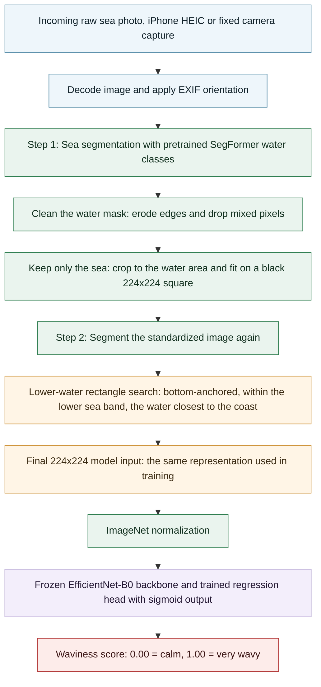
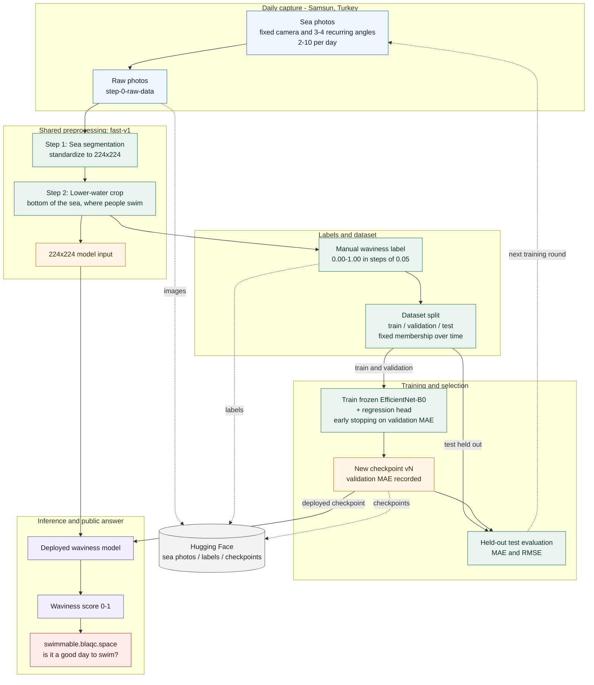

# Pipeline flow

Two views of the same system:

1. **One incoming photo** — the inference path from a raw sea photo to a waviness score.
2. **Full lifecycle** — capture, preprocessing, labeling, splitting, training, deployment, the public website, and the retraining loop.

The technical training stack is a separate document: [training-stack.md](training-stack.md).

## Context

- This is a localized project for **Samsun, Turkey**. Photos come from a fixed location and camera, with 3–4 recurring angles, usually 2–10 photos per day.
- The **lower part of the sea** matters most: it is the water closest to the coast and to the people swimming. The Step 2 crop therefore prefers bottom-anchored rectangles inside the lower sea band.
- The public GitHub repository holds **code only**. Sea photos, labels, and checkpoints are stored and shared through **Hugging Face**.
- Training data and inference use the same preprocessing profile (`fast-v1`): single-pass 448 px segmentation for Step 1, 384 px segmentation for Step 2, float16 on GPU, and a 224×224 model input.

## 1. One incoming photo — inference

### What each stage is doing

- **Decode**: opens the iPhone HEIC or camera image and normalizes its EXIF orientation, so the scene is upright before any processing.
- **Step 1 — sea segmentation**: the pretrained SegFormer identifies water classes (`water`, `sea`, `river`, `lake`). The mask is cleaned, the detected water is cropped, non-water pixels are blacked out, and the result is fitted onto a black 224×224 square. This removes sky, buildings, beach, and sand.
- **Step 2 — lower-water crop**: the standardized image is segmented again, and a bottom-anchored rectangle is selected from the lower sea band. That region is the water nearest the coast and nearest the swimmers.
- **Model input**: the selected crop is resized to 224×224 and normalized, which is exactly the representation the regression model was trained on.
- **Regression**: the frozen EfficientNet-B0 backbone extracts features, the small trained head produces one value, and the sigmoid keeps the score in `[0, 1]`.

The inference path recreates the training representation from a single raw photo. Step 2 works on the Step 1 standardized image, not on the original photo.

## 2. Full lifecycle — capture, training, inference, and retraining

### The two loops

Solid arrows show data and model flow; dotted arrows show storage and synchronization with Hugging Face.

- **Daily loop**: new photos arrive, pass through the shared preprocessing, are scored by the deployed model, and become the public swimmability answer on the website.
- **Retraining loop**: new photos are labeled, the fixed-membership split is updated with only the new samples, the model is retrained, a new versioned checkpoint is evaluated on the held-out test set, and that checkpoint becomes the deployed model. Existing images do not need to be reprocessed, and previous splits and checkpoints remain reproducible.

### Where things live

- **GitHub**: pipeline code, documentation, and experiment reports. No sea photos, masks, overlays, labels, or checkpoints.
- **Hugging Face**: the growing photo dataset, labels, and versioned checkpoints. The deployed inference pulls its checkpoint from there.
- **Website**: `https://swimmable.blaqc.space/` turns the current photo's waviness score into a practical answer for people deciding whether to swim.
