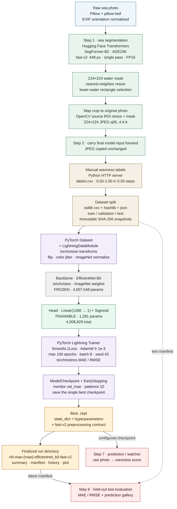

# Training stack — from raw photo to checkpoint

This is the current production training path (`fast-v2`), kept separate from the conceptual views in [pipeline-flow.md](pipeline-flow.md). It shows the models, libraries, and checkpoint contents rather than the experiment branches. `baseline-v16` and the legacy ResNet-18 option remain available in the code but are not part of this path.

An editorial HTML version of the same diagram is available in [training-stack-editorial.html](training-stack-editorial.html).

### Reading the stack

- **Two different model roles.** SegFormer-B2 is a preprocessing model, not the model being trained. It generates the Step 1 water mask. The only learned weights in the output checkpoint are the regression head on top of the frozen EfficientNet-B0.
- **Frozen backbone.** EfficientNet-B0 starts from torchvision's ImageNet weights. All backbone parameters are frozen, and BatchNorm stays in evaluation mode; only `Linear(1280, 1) + Sigmoid` is trainable, which is 1,281 of 4,008,829 parameters.
- **Selection and stopping.** `ModelCheckpoint` and `EarlyStopping` both monitor `val_mae`. Training is deterministic with seed 42, runs for at most 100 epochs, and saves only the single best checkpoint. The test split is not read during training.
- **Run finalization.** The best checkpoint is reloaded with `pretrained=False`, validated again, and the pending run directory is renamed to `vN-mae-<mae>-efficientnet_b0-fast-v2`. The summary, manifest, history CSV, and plot are written into that directory.
- **Batch preprocessing.** Step 1 can use multiple process workers, each loading its own SegFormer model; the worker count is chosen from free GPU memory and available RAM. The `fast-v2` profile requires CUDA.

### Training stack at a glance

| Layer | Tool or model | Role |
| --- | --- | --- |
| Image decoding | Pillow, pillow-heif | HEIC/JPEG decoding and EXIF orientation |
| Sea segmentation | Hugging Face Transformers, `nvidia/segformer-b2-finetuned-ade-512-512` (SegFormer-B2, ADE20K) | Step 1 water mask at 448 px |
| Mask and crop math | OpenCV and NumPy | 224 px mask selection and source-coordinate crop |
| Labeling UI | Python standard library `http.server` | Local web app that writes `labels.csv` |
| Split and provenance | Python standard library `csv`, `hashlib`, `json`, `random` | Manifests, SHA-256 hashes, immutable snapshots |
| Dataset | PyTorch `Dataset`, Lightning `LightningDataModule`, torchvision transforms | Loads Step 2 JPEGs, augments, batches |
| Backbone | torchvision `efficientnet_b0` with `EfficientNet_B0_Weights.DEFAULT` | Frozen ImageNet feature extractor |
| Regression head | PyTorch `nn.Linear(1280, 1)` + `nn.Sigmoid` | Trainable output layer |
| Trainer | PyTorch Lightning `Trainer`, `ModelCheckpoint`, `EarlyStopping` | Fit, validate, early stop, save best |
| Metrics | torchmetrics `MeanAbsoluteError`, `MeanSquaredError` | Validation MAE/RMSE and training MAE |
| Loss and optimizer | `nn.SmoothL1Loss`, `torch.optim.AdamW` | Regression loss and head-only optimization |
| Checkpoint | Lightning `.ckpt` plus the custom preprocessing contract | Portable model artifact |
| Reports | JSON, CSV, Matplotlib | Run summary, manifest, history, and plots |
| Runtime on this machine | Python 3.14.8, PyTorch 2.14.0+rocm10.1.0 (AMD gfx1151) | Device selection; CUDA and CPU alternatives exist |
| Experiment tracking | None (no MLflow or W&B) | JSON/CSV files are the record |

### What the saved checkpoint contains

For a checkpoint trained with fast-v2, the `.ckpt` contains:

- `state_dict`: 360 tensors, including the full frozen backbone and the trained head.
- `hyper_parameters`: `learning_rate=0.001`, `backbone_name="efficientnet_b0"`, `pretrained=True`.
- `epoch` and `global_step`: the best validation epoch and step.
- `optimizer_states`, `lr_schedulers`, `loops`, `callbacks`: Lightning training bookkeeping.
- `pytorch-lightning_version`.
- `fast_preprocessing_experiment`: the profile, segmentation model and revision, 448 px resolution, null Step 2 resolution, float16 precision, 448 px logits resolution, coordinate-crop flag, device, PyTorch version, and hashes for the relevant preprocessing, model, selector, and predictor code.

The checkpoint is reloaded for evaluation or inference with `pretrained=False`. For fast-v2 checkpoints, the recorded contract is checked first, so the checkpoint cannot silently run against different preprocessing code or settings.

**Scope note:** this diagram is the current production path. The training CLI also accepts `--backbone resnet18` for legacy checkpoints, and `baseline-v16` remains available for CPU or legacy preprocessing; neither is shown here.
